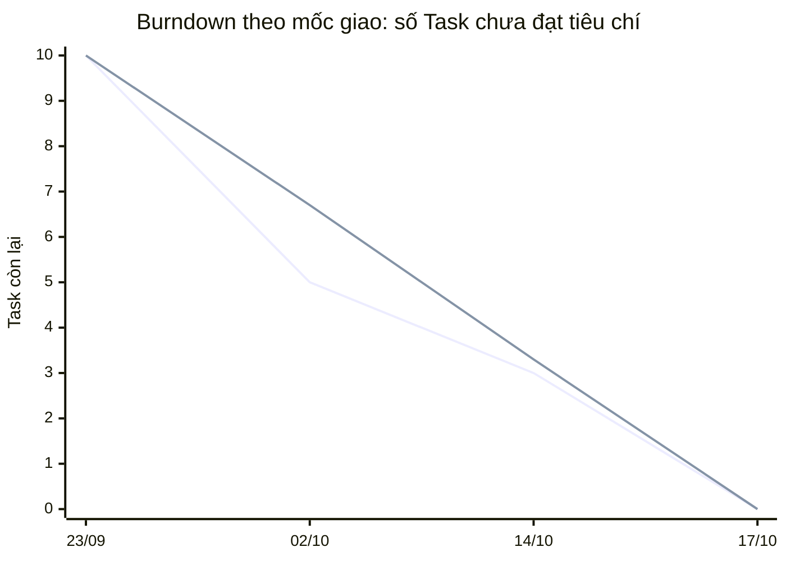
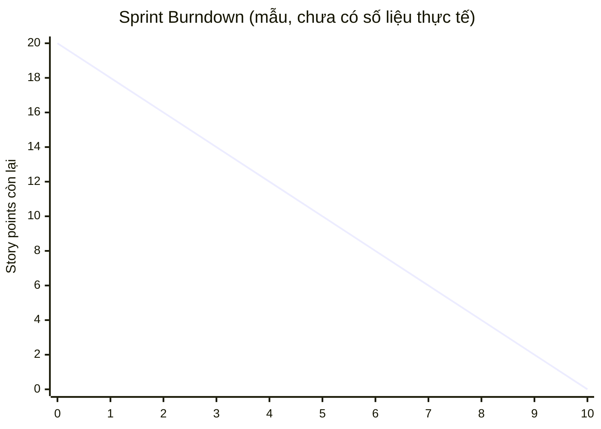

# Burndown

Burndown chart theo dõi khối lượng công việc còn lại giảm dần theo thời gian. Đường **lý tưởng** giảm đều; đường **thực tế** phản ánh tiến độ thật. Thực tế nằm trên lý tưởng nghĩa là đang chậm; nằm dưới nghĩa là vượt tiến độ.

## 1. Burndown thực tế của bản cá nhân (theo mốc giao)

**Quy ước:** mỗi Task trong đề tương đương 1 điểm. "Còn lại" là số Task **chưa đạt đầy đủ tiêu chí chấp nhận** của đề tại mốc đó.

> Đây là burndown **theo mốc giao**, không phải theo từng ngày, vì bản cá nhân không ghi số liệu hằng ngày. Dữ liệu lấy từ lịch sử Git và lần rà soát đối chiếu tiêu chí ngày 14/10.

| Mốc | Ngày | Còn lại (thực tế) | Còn lại (lý tưởng) | Căn cứ |
|---|---|---|---|---|
| Khởi tạo | 23/09 | 10 | 10 | Initial commit |
| Giao 1 | 02/10 | 5 | 6,7 | Task 1–5 hoàn thành |
| Rà soát theo PDF | 14/10 | 3 | 3,3 | Task 6, 7 đạt; Task 8 (thiếu thẻ), 9 (chưa chạy được Docker/demo), 10 (test chỉ dùng mock, thiếu UI khuyến mãi) chưa đủ |
| Giao 3 | 17/10 | 0 | 0 | PR #1, #2, #3: Task 8, 9, 10 đạt đủ tiêu chí |

Đường thứ nhất là **thực tế** (10, 5, 3, 0); đường thứ hai là **lý tưởng** (10, 6,7, 3,3, 0).

## 2. Mẫu để nhóm điền

Số liệu dưới đây để trống, không phải số của dự án.

| Ngày làm việc | Lý tưởng | Thực tế |
|---|---|---|
| 0 | 20 | |
| 1 | 18 | |
| 2 | 16 | |
| 3 | 14 | |
| 4 | 12 | |
| 5 | 10 | |
| 6 | 8 | |
| 7 | 6 | |
| 8 | 4 | |
| 9 | 2 | |
| 10 | 0 | |

## 3. Nguồn số liệu

- Bản cá nhân không có ghi nhận hằng ngày, nên burndown ở mục 1 là theo mốc giao, không theo ngày.
- Các mốc lấy từ ngày commit trong Git: 23/09 (Initial commit), 02/10 (Task 1–5), 14/10 (MVP Task 6–10), 17/10 (PR #1, #2), 18/10 (PR #3, #4), 22/10 (tài liệu, hiệu năng).
- Hai commit ngày 07/11 là đưa repo lên lại, không tính là ngày phát triển.
- Nhóm cần điền burndown hằng ngày từ số liệu thực tế trong Daily Scrum, không sao chép số từ tài liệu này.
